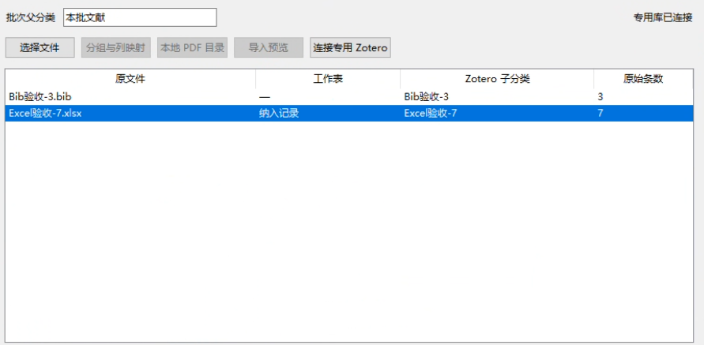
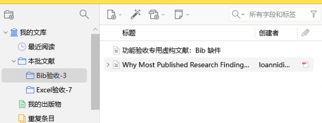

# Literature Desk · 文献正文获取工具

Windows 10/11 x64 桌面程序。把 BibTeX 和 Excel 题录按组送入专用 Zotero，优先复用已有正文，逐篇记录获取结果，最后交付 PDF 和仍缺正文的题录。

**第一次使用**请打开 [1.3.0 发行页](https://github.com/cHEn525s/Literature-Desk/releases/tag/v1.3.0)，下载标为 **异机验收包** 的 ZIP（文件名为 `LiteratureDesk-1.3.0-Windows-x64-demo.zip`）。里面有安装程序、两个练习文件和离线说明。

**已有版本升级**：使用原 Windows 账户，先暂停正在运行的批次并正常关闭桌面端和专用 Zotero，运行本版 Setup.exe 覆盖安装。若希望累计首轮成果，打开历史批次后点「只重跑未取得」。重新导入导出的缺件文件会单独建批。

## 一、前置准备

| 软件 | 谁需要 | 获取地址 |
| --- | --- | --- |
| Zotero 10 桌面版 | 所有使用者；本机验证版本 10.0.8 | [Zotero 官方下载](https://www.zotero.org/download/) |
| Zotero Sci-Hub | 使用当前下载端前，先在常用 Zotero 配置中安装；本机验证版本 2.0.1 | [作者发布页](https://github.com/ethanwillis/zotero-scihub/releases) |
| Zotero Linter | 可选，用于检查、整理题录字段 | [作者发布页](https://github.com/northword/zotero-format-metadata/releases) |
| ZotMeta | 可选，用于更新已有条目的元数据。两款可选插件需在实际处理条目的 Zotero 配置中启用 | [作者发布页](https://github.com/RoadToDream/ZotMeta/releases) |
| Python | 仅从源码开发或构建时需要；安装版和应用压缩包均自带运行环境 | [Python 官方 Windows 下载](https://www.python.org/downloads/windows/) |

## 二、安装与连接

1. 解压异机验收包，双击 **Setup.exe**，按向导安装。需要桌面入口时勾选「创建桌面快捷方式」。已有样例的同学也可以在发行页单独下载安装程序。
2. 打开「Literature Desk」。想把文库和附件放在 D 盘，可先点「文库位置」选择本机固定磁盘上的父文件夹。迁移已有文库时先关闭专用 Zotero，等待复制及校验结束。
3. 点「连接专用 Zotero」。第一次连接会配置随包的自研桥接插件，并复制本机已有的下载插件。出现定位框时选择已安装的 zotero.exe。看到「专用库已连接」即可。
4. 如选择发行页的 **应用 ZIP**，先完整解压到可写目录，再运行 LiteratureDesk.exe。请保留同目录内的运行库及 bridge 文件夹。批次进度保存在当前用户的本地工作区。

### 换网、切换站点与人工验证

连接专用 Zotero 后点「站点管理」。首次打开会读回插件实际地址。列表提供 11 个预置入口，可自行添加、编辑或移除。点「测试所选」或「测试全部」，使用固定开放获取论文（DOI 为 `10.1371/journal.pmed.0020124`）检查当前网络能否取得对应 PDF。结果显示「可获取 PDF」「需要人工验证」或失败原因。选择合适的地址后点「设为当前」，软件会读回插件设置。运行中的任务请先暂停并等当前请求结束。

遇到人机验证时，点「打开验证页」，在同一个专用 Zotero 中完成操作，再点「已完成验证，继续当前篇」。程序优先检查该篇已有附件。首次升级若提示桥接版本过旧，正常关闭专用 Zotero，再从桌面端重新连接。

## 三、用两个样例完成第一批

1. 点「选择文件」，同时选择 **Bib验收-3.bib** 和 **Excel验收-7.xlsx**。父分类可填「首次练习」。
2. 选中 Excel 行，点「分组与列映射」，选择「纳入记录」工作表，核对标题、DOI、PMID 和来源记录号等列。已有 PDF 可通过「本地 PDF 目录」加入候选。
3. 点「导入预览」。两组应分别显示 **3 条、7 条**，共 10 条原始题录，归并为 7 篇论文。确认后点「开始」。

4. 到专用 Zotero 查看父分类下的两个子分类。相同论文可以同时属于两个组。截图中的「本批文献」是当次使用的父分类名。

5. 完成后点「导出交付」，选择可写目录。打开分组汇总，比对各组的「已取得＋未取得＝原始条数」。样例故意包含缺件和身份冲突；若两篇预期论文均取得可读 PDF，预期交付 **2 份 PDF**，Bib 组取得 2 条、缺 1 条，Excel 组取得 3 条、缺 4 条。实际获取数受附件和下载端影响。

## 四、日常功能

| 我想做什么 | 操作与结果 |
| --- | --- |
| 优先利用手里的 PDF | 导入预览前添加本地 PDF 目录。已绑定题录的可读 PDF 即计为取得，包括扫描件与摘要。正文身份、类型和完整性可在后续工作流审核。 |
| 暂停，过后继续 | 点「暂停」，等当前条目结束并保存停点。重开工具后点「继续」。遇到验证提示时，在专用 Zotero 处理后继续。 |
| 结束本批，切换其他文件 | 点「中止任务」。已处理结果可以导出；已提交给插件的单篇调用可能仍会结束。 |
| 用同一组输入从头开始 | 完成或中止后点「用原题录新建批次」，再点「开始」。 |
| 找回历史批次 | 点「打开历史批次」，用原文件名、时间和取得数选回之前的整批记录。 |
| 只处理剩余论文 | 完成或中止后点「只重跑未取得」。界面显示保留和待处理篇数，再点「开始」。程序核对已取得 PDF 的哈希，导出时汇总整批累计结果。 |
| 定位缺件原因 | 查看逐条结果中的原因码。例如 no_doi 表示缺下载所需的 DOI，not_found 表示插件未取得正文，旧批次中的 wrong_attachment 表示当时未通过旧版核验；重跑会重新检查可用附件。 |

**交付目录**中，正文PDF 每篇一份；同条目其他可读 PDF 单列在「同条目其他PDF」，并在逐条结果中关联；未下载题录保留原字段，分别导出 Bib 或 Excel；分组汇总.csv 可用 Excel 查看；逐条结果.jsonl 含来源位置、论文标识、状态、原因和正文路径。跨组引用同一份 PDF 时，两组对应题录各计一次取得。整组完成时，汇总表的缺件数为 0。

## 五、补全 DOI 或 PMID 后如何处理

先从「未下载题录」或逐条结果定位缺件，用 Linter 检查字段，用 ZotMeta 尝试更新元数据，再对照标题、作者和年份确认 DOI、PMID 确属同一论文。两者都缺失时，可能需要人工检索。程序能从 PubMed URL 提取 PMID；1.3.0 的在线下载端需要 DOI。

**1.3.0 的重跑读取原批次快照。** 只在 Zotero 中改 DOI 后直接点「只重跑未取得」，新 DOI 不会自动回到旧批次。请按情况选择：

- **已补到了 DOI**：把更正后的 DOI 回填到导出的缺件 Excel 或 Bib 副本；也可从 Zotero 导出更正后的条目为新 Bib。用「选择文件」导入这份缺件清单，点「导入预览」再「开始」。本次只处理所选缺件，原批次留存，新批次单独导出。
- **原快照已有可核验的标识，后来取得了匹配的 PDF**：把正文添加到专用 Zotero 的对应条目，再点原批次的「只重跑未取得」和「开始」。程序会重新检查附件；通过核验后，可导出整批累计结果。
- **仍只有 PMID**：可用于去重和已有正文的核验。需要在线尝试时，先补 DOI，再走第一条路径。

## 六、版本与维护

[发行页](https://github.com/cHEn525s/Literature-Desk/releases)按版本保存安装程序、完整应用、验收包和 SHA-256 校验值。当前标签为 v1.3.0。下载最新包即可得到绿色书本桌面和标题栏图标。可直接将发行页链接分享给同门，无需登录即可下载。

`intake` 提供输入解析、分组和本地匹配，`desktop` 提供桌面界面、执行引擎、桥接和导出，`packaging` 提供 Windows 入口与打包脚本。早期阶段脚本为开发验证记录，部分测试需开发者自备原始样例。日常功能演示使用`examples` 目录中的两份专用题录。

[下载上一版 1.2.0](https://github.com/cHEn525s/Literature-Desk/releases/tag/v1.2.0)

## 版本记录

- **1.2.0** 新增「打开历史批次」，放宽已绑定附件的 PDF 取得条件，支持多份附件关联。缺件重跑核对并继承已有成功记录，按原始整批累计导出。
- **1.3.0** 新增站点管理、固定论文测试和应用内切换站点。人工验证后可继续当前篇，继承 1.2.0 的历史批次和累计交付。
